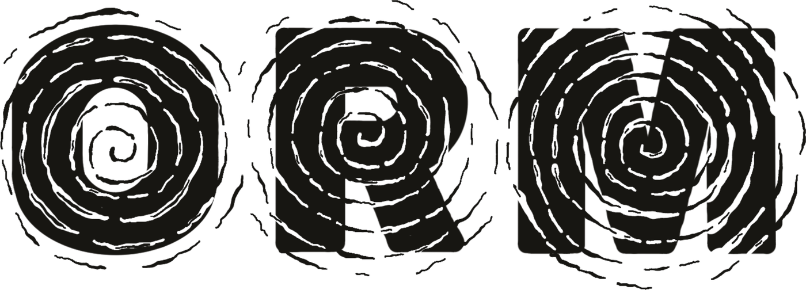
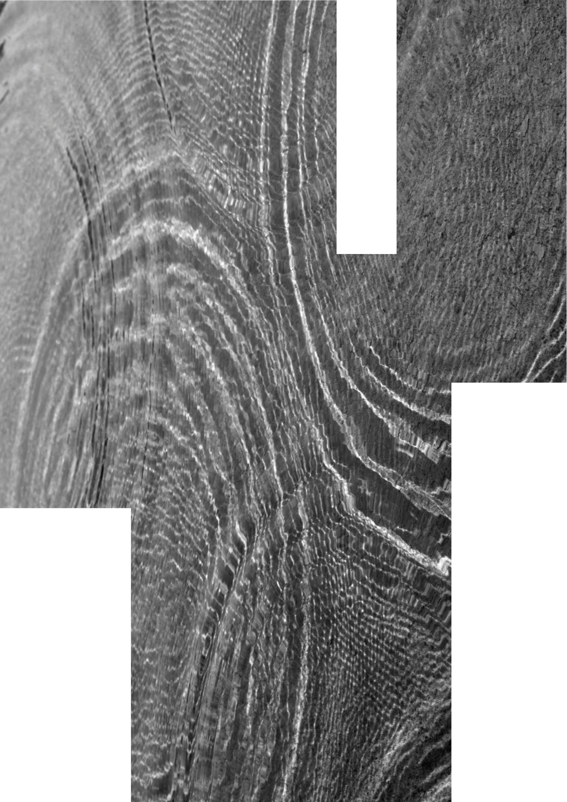

```{=html}
<div class="orm-cover">

  

  <p class="orm-cover__tagline">
    <span class="orm-cover__slashes">//</span>
    A guide to <b>open research</b> practices <br>for <b>music</b> researchers
  </p>

  <figure class="orm-cover__photo">
    

    <span class="orm-cover__rings-a" aria-hidden="true"></span>
    <span class="orm-cover__rings-b" aria-hidden="true"></span>
  </figure>

  <p class="orm-cover__authors">
    Eerola, Devaney, Hartmann,<br>
    Herremans, Moss, Stupacher,<br>
    &amp; van der Walle
  </p>
</div>
```
[Preface](preface.qmd){.btn .btn-primary}
[Resources](resources.qmd){.btn .btn-outline-secondary}

# Open Research for Music

This repository offers a guide to Open Research practices for music research, particularly aimed for music psychology and computational musicology, but also relevant for music information retrieval, music education, music technology, and musicology. 

## Motivation

In music research, there is room for improvement in _transparency_ and _reproducibility_, to widen the _accessibility_ and _equity_ with Open access to publications and data ensures that researchers, practitioners, and the public can benefit from scientific knowledge. Also, _innovation_ and _collaboration_ benefits from Open Research. A good teaching material dedicated to music research is missing at the moment and this repo attempts to fill this gap.

## Authors

This is a collaborative enterprise, where various authors contribute to specific sections and themes, see also @sec-preface.

- Tuomas Eerola (Finland), see [Department of Music, Arts, and Culture, University of Jyväskylä, Finland](https://www.jyu.fi/en/people/tuomas-eerola/)
- Johanna Devaney (US), see [Brooklyn College, CUNY](https://www.brooklyn.edu/faculty-staff/johanna-devaney/)
- Martin Hartmann (Finland), see [Centre of Excellence in Music, Mind, Body and Brain](https://www.jyu.fi/en/people/martin-hartmann)
- Dorien Herremans (Singapore), see [Audio, Music, and AI (AMAAI) Lab at Singapore University of Technology and Design](https://dorienherremans.com/biography)
- Fabian Moss (Germany), see [Institut für Musikforschung at Julius-Maximilians University Würzburg](https://fabian-moss.de)
- Jan Stupacher (Denmark), see [Center for Music in the Brain](https://fabian-moss.de)
- Hazel van der Walle (UK), see [Department of Music, Durham University](https://www.durham.ac.uk/staff/hazel-a-van-der-walle/)


## Organisation

- [Preface](preface.qmd) explains the rationale and the broader picture

- [Open publications](section2.qmd) covers the availability of research output and publications 

- [Open data](section3.qmd) handles the availability of research data 

- [Reproducible research](section4.qmd) is about reproducible research, research code and software

- [Replication studies](section5.qmd) explains the purpose of replicating studies

- [Open peer review](section6.qmd) covers open peer review and post-publication peer review

- [Preregistration](section7.qmd) details study preregistration

- [Resources](resources.qmd) offers links to online resources

